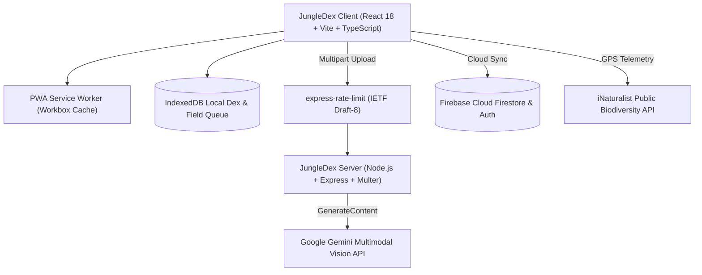

# JungleDex 🌿 — The Living World Dex

[](https://opensource.org/licenses/MIT)
[](https://www.typescriptlang.org/)
[](https://react.dev/)
[](https://vitejs.dev/)
[](https://nodejs.org/)
[](https://web.dev/progressive-web-apps/)
[](https://aistudio.google.com/)

> **Turn real-world nature discoveries into holographic 3D collectible cards.**  
> JungleDex is a gamified outdoor exploration platform that blends multimodal computer vision with tactile, retro handheld hardware aesthetics. Snap photos of plants, birds, insects, and scenic vistas to identify specimens, build your catalog, and level up your outdoor expeditions.

---

## 🌟 Key Features

### 📸 Multimodal AI Field Scanner
- **Instant Species & Terrain Identification**: Point your camera at any organism or landscape to receive binomial classification, confidence metrics, and ecological field notes via Google Gemini Vision.
- **AI-Generation Detector**: Inspects whether an uploaded nature image is a genuine camera photograph or a synthetic AI render (Midjourney / DALL-E / 3D model).

### 🎴 Living Field Dex & 3D Holographic Foil
- **Tactile Hologram Cards**: Tilt your device or cursor to illuminate dynamic metallic foil sheens across Common, Uncommon, Rare, Epic, and Legendary rarities.
- **Export & Share**: Generate and download high-resolution PNG specimen cards for sharing on social media or messaging platforms.
- **Specimen Dossier**: Detailed binomial taxonomy, observation facts, and regional habitat data.

### 🕹️ Retro Pokédex Chassis & 8-Bit Audio
- **Hardware Chassis Mode**: Authentic Kanto-inspired cyber-dex shell complete with blinking triple-LED status clusters, a cyan optic lens bezel, and tactile typography.
- **Synthesized Chiptune Audio**: Built with the HTML5 Web Audio API—generates real-time 8-bit sound effects directly on-device without external audio files.
- **Theme Palette**: Switch on the fly between **Classic Pokédex**, **Verdant Forest**, **Enchanted Obsidian**, and **Cosmic Void**.

### 📡 Real-Time Biodiversity Radar
- **Community Wildlife Mapping**: Harnesses open public biodiversity telemetry from the iNaturalist API to plot active community sightings within a 5 km walking radius.
- **Lock Target**: Select any specimen discovered on the radar to set it as an active GPS quest objective.

### 🏃 GPS Expeditions & Field Quests
- **Hardware Stride Tracking**: Uses hardware GPS telemetry and Haversine distance calculations to record real-world ground distance and strides without phantom laptop drift.
- **Gamified Missions**: Daily exploration objectives (e.g., *Find 2 Waterscapes*, *Scan a Pollinator*) awarding Explorer XP, rank levels, and milestone badges.

### 📶 Wilderness Offline Mode & PWA
- **PWA Service Worker**: Installable on iOS, Android, macOS, and Windows with offline caching.
- **Offline Field Queue**: When trekking deep in remote wilderness with zero cellular signal, photos and GPS coordinates are preserved in local **IndexedDB**.
- **Auto-Sync**: Queued observations automatically run through Gemini AI and sync as soon as network signal is restored.

### 🛡️ Enterprise Security & Rate Limiting
- **Defensive API Hardening**: Secured with `helmet` CSP headers, CORS origin whitelisting, and strict payload size limits.
- **Rate Limiting**: Protected with `express-rate-limit` using IETF Draft-8 standards (`RateLimit-*` headers) and custom 429 response handling.
- **Freemium 1-Scan Trial**: Unauthenticated guests get 1 free trial scan; creating an account migrates their trial discovery directly to their permanent cloud collection.

---

## 🏗️ Architecture & Tech Stack



### Technology Breakdown

- **Frontend**: React 18, TypeScript, Vite 6, Lucide React, HTML5 Web Audio API, IndexedDB API, `vite-plugin-pwa`
- **Backend**: Node.js 20+, Express 4, Multer, Helmet 8, `express-rate-limit`
- **Cloud & Auth**: Firebase Auth (Google OAuth & Email/Password), Cloud Firestore
- **AI Vision**: Google Gemini Multimodal Vision (`gemini-3.5-flash`)
- **External Data**: iNaturalist API (Radar biodiversity), Open-Meteo & Nominatim (Environmental context)

---

## 📁 Repository Structure

```
jungledex/
├── client/                     # Frontend Single Page Application
│   ├── public/                 # Static assets, PWA icons
│   ├── src/
│   │   ├── components/         # TopBar, DiscoveryCard, Workbench, BottomNav, AuthModal
│   │   ├── pages/              # HomePage, DexPage, ScannerPage, RadarPage, ExpeditionsPage
│   │   ├── services/           # api.ts, db.ts (IndexedDB), firebase.ts, geo.ts, radar.ts, sound.ts
│   │   ├── styles.css          # Design system, themes & holographic foil animations
│   │   └── App.tsx             # State coordinator & hash router
│   ├── vite.config.ts          # Vite build config with PWA caching rules
│   └── package.json
├── server/                     # Backend API & AI Gateway
│   ├── src/
│   │   └── index.ts            # Express server, rate limiting, helmet & Gemini AI gateway
│   └── package.json
├── package.json                # Root monorepo workspace configuration
├── .gitignore                  # Production Git ignore patterns
└── LICENSE                     # MIT Open Source License
```

---

## 🚀 Quick Start

### Prerequisites
- **Node.js** v20.0.0 or higher
- **npm** v10.0.0 or higher
- A **Google AI Studio API Key** ([Get your free key here](https://aistudio.google.com/))
- *(Optional)* A **Firebase Project** for cloud sync ([Firebase Console](https://console.firebase.google.com/))

### 1. Clone & Install Dependencies

```bash
git clone https://github.com/your-username/jungledex.git
cd jungledex
npm install
```

### 2. Configure Environment Variables

#### Backend (`server/.env`)
Create `server/.env` (or copy from `server/.env.example`):

```bash
cp server/.env.example server/.env
```

```env
PORT=8787
CLIENT_ORIGIN=http://localhost:5173
GOOGLE_API_KEY=your_google_ai_studio_api_key_here
GOOGLE_MODEL=gemini-3.5-flash
```

#### Frontend (`client/.env`)
Create `client/.env` (or copy from `client/.env.example`):

```bash
cp client/.env.example client/.env
```

```env
VITE_API_URL=http://localhost:8787

# Optional: Add Firebase credentials to enable cross-device cloud sync
VITE_FIREBASE_API_KEY=
VITE_FIREBASE_AUTH_DOMAIN=
VITE_FIREBASE_PROJECT_ID=
VITE_FIREBASE_STORAGE_BUCKET=
VITE_FIREBASE_MESSAGING_SENDER_ID=
VITE_FIREBASE_APP_ID=
```

*(Note: If Firebase credentials are left blank, JungleDex seamlessly runs in offline/local-only mode using IndexedDB!)*

### 3. Launch Development Servers

Run both the frontend and backend concurrently from the root directory:

```bash
npm run dev
```

- **Frontend Client**: `http://localhost:5173`
- **Backend API**: `http://localhost:8787`
- **API Health Check**: `http://localhost:8787/api/health`

---

## 🛠️ Build & Production Deployment

### Build Monorepo

```bash
# Compiles TypeScript and bundles client & server
npm run build
```

### Deployment on Render (Recommended)

This repository includes a pre-configured [`render.yaml`](render.yaml) Blueprint that automatically provisions both the backend API and frontend static site.

#### Option A: Automatic 1-Click Blueprint
1. Push this repository to **GitHub**.
2. Log into [Render.com](https://dashboard.render.com/).
3. Click **"New +"** → **"Blueprint"**.
4. Connect your `jungledex` GitHub repository.
5. Render reads `render.yaml` and sets up both:
   - `jungledex-api` (Express Node Web Service)
   - `jungledex-web` (React Vite Static Site with SPA rewrites)
6. In the environment prompts, enter your `GOOGLE_API_KEY`.
7. Click **Apply** to deploy!

#### Option B: Manual Setup
1. **Backend Web Service (`jungledex-api`)**:
   - Environment: `Node`
   - Build Command: `npm install && npm run build -w server`
   - Start Command: `npm run start -w server`
   - Environment Variables:
     - `PORT`: `10000` (Render default)
     - `GOOGLE_API_KEY`: *(Your Google AI Studio Key)*
     - `GOOGLE_MODEL`: `gemini-3.5-flash`
     - `CLIENT_ORIGIN`: `https://YOUR-FRONTEND-URL.onrender.com`

2. **Frontend Static Site (`jungledex-web`)**:
   - Build Command: `npm install && npm run build -w client`
   - Publish Directory: `client/dist`
   - Rewrite Rule: `/*` → `/index.html`
   - Environment Variables:
     - `VITE_API_URL`: `https://YOUR-API-URL.onrender.com`

---

## 📡 API Reference

### `GET /api/health`
Health and AI configuration status.
- **Response**: `200 OK`
```json
{
  "ok": true,
  "app": "JungleDex API",
  "aiConfigured": true,
  "model": "gemini-3.5-flash"
}
```

### `POST /api/identify`
Analyzes an uploaded nature photo and returns formatted ecological data.
- **Content-Type**: `multipart/form-data`
- **Body**: `image` (JPEG, PNG, or WEBP, max 10MB)
- **Rate Limit**: 10 requests / minute per IP
- **Response**: `200 OK`
```json
{
  "name": "Monarch Butterfly",
  "scientificName": "Danaus plexippus",
  "category": "Insect",
  "rarity": "Uncommon",
  "confidence": "High",
  "description": "A milkweed butterfly renowned for its vibrant orange and black wing patterns.",
  "facts": [
    "Undergoes one of the most famous long-distance insect migrations in North America.",
    "Caterpillars feed exclusively on milkweed plants, making them unpalatable to predators.",
    "Observe from a gentle distance without disturbing feeding pollinators."
  ],
  "isAiGenerated": false,
  "aiGenerationReason": "",
  "modelUsed": "gemini-3.5-flash"
}
```

---

## 🌿 Responsible AI & Outdoor Ethic

- **Wildlife First**: Never handle, capture, or disturb wild organisms. Keep a respectful distance and leave natural habitats undisturbed.
- **Educational Guidance**: Identifications provided by JungleDex are suggestions generated by generative AI. They are intended for educational and observation purposes, not for foraging, medical advice, or edible plant/fungi verification.
- **Privacy Conscious**: GPS coordinates are optional and stored locally on your device by default.

---

## 📄 License

This project is licensed under the **MIT License** — see the [LICENSE](LICENSE) file for details.
